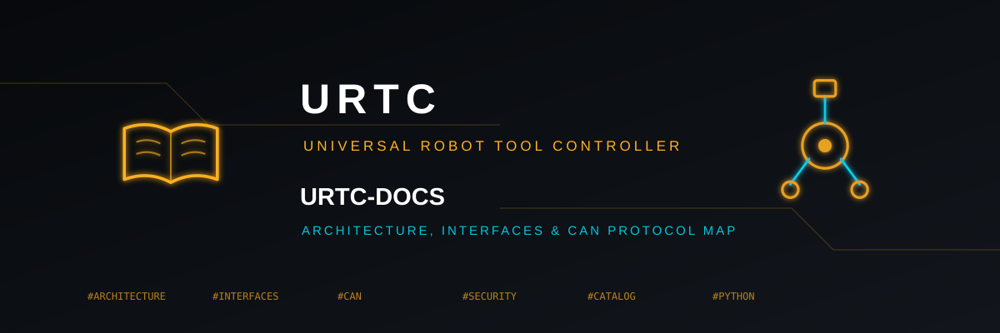
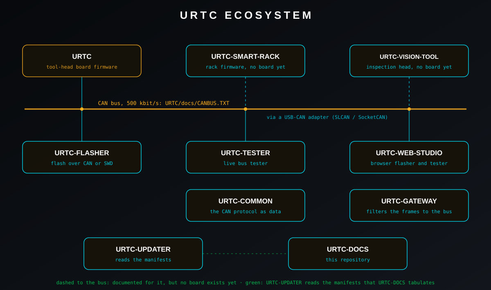

<p align="center">
  
</p>

# 📚 URTC-DOCS

<p align="center">🇺🇸 <b>English</b> | <a href="README_spa.md">🇪🇸 Español</a> | <a href="README_fra.md">🇫🇷 Français</a> | <a href="README_ita.md">🇮🇹 Italiano</a> | <a href="README_deu.md">🇩🇪 Deutsch</a> | <a href="README_zho.md">🇨🇳 简体中文</a> | <a href="README_jpn.md">🇯🇵 日本語</a> | <a href="README_por.md">🇵🇹 Português</a></p>

### Architecture, interfaces, security baseline and the truth about what is proven

<p align="center">
  
  
  
  
  
</p>

---

**Honesty check - what actually runs today:** this repository holds documents and small tools. The tools (the catalogue generator, the brand generator, the README generator, the publication check and the family check) are real and have unit tests that run in CI; the nightly workflow runs them against the other repositories of the family. The documents are written from the READMEs, manifests, changelogs and documents of those repositories as they were read for this version, and a statement that could not be traced to a repository is marked as such. Nothing here is a hardware test: the capability matrix says, for each capability, whether it was only simulated, tested on a computer or run on real hardware, and the firmware repository states that no populated board exists yet.

---

> **Safety and security status:** this ecosystem is not a certified safety system, and no populated URTC board exists yet. The bootloaders check firmware images with CRC32 and a shared-key HMAC-SHA256, not with an asymmetric signature (planned); the published application images are signed with the public development key (`signing_key_kind: dev`), so anyone can produce an image the bootloader accepts; nothing has been transmitted to a real board. Read the [security baseline](docs/SECURITY_BASELINE.md) and the [threat model](docs/THREAT_MODEL.md) before relying on any statement here for the safety of a person.

## 📋 At a glance

| | |
|---|---|
| Version | `0.0.5` |
| Maturity | Scaffolding |
| Stack | Markdown / Mermaid / Python / SVG |
| Target | The PC of the person using it |
| On real hardware | Not applicable: nothing here runs on hardware |

## 🎯 Overview

<p align="center">
  
</p>

The picture below shows the repositories of URTC, the CAN bus that joins the boards and the host tools, and the links that their documents state.

* [Architecture](docs/ARCHITECTURE.md): layers, data flows, ports and trust boundaries.
* [Interfaces](docs/INTERFACES.md): who owns each contract and where it is documented.
* [Capability matrix](docs/CAPABILITY_MATRIX.md): what is proven in software and what needs hardware, project by project.
* [Security baseline](docs/SECURITY_BASELINE.md): what the code enforces and what is still missing; and the [threat model](docs/THREAT_MODEL.md).
* [First vertical slice](docs/FIRST_VERTICAL_SLICE.md): the smallest end-to-end path that exists today.
* [CAN protocol duplication](docs/CAN_PROTOCOL_DUPLICATION.md): the protocol is implemented three times from prose; what a shared specification would hold.
* [Project catalogue](docs/PROJECT_CATALOG.md): every repository of the ecosystem, written from its own manifest.
* **Tools:** `make_catalog.py` writes the catalogue, `make_brand.py` the banner, icon and family map, `make_readmes.py` the eight READMEs of this repository, `publication_check.py` looks for anything private before a publication, and `check_all.sh` runs the own checks of every repository of the family and prints one PASS, FAIL or SKIP line each. `make_glance.py` writes the At a glance table of every repository from its manifest and from `data/glance.json` (`--check` compares, `--apply` writes); after a version bump, `python tools/make_glance.py --apply --repo NAME` refreshes the table of that repository. `check_claims.py` reads the English README of every repository of the family and fails when a sentence has a risk word (E-STOP, interlock, real-time, signed, mTLS, FDCAN, YOLO, AI-driven, autonomous, certified, ...) and no status marker next to it (planned, not implemented, optional, off by default, simulated, tested, ...), unless a person has read that line next to the code and put it in `data/claims_reviewed.json`. `urtc_doctor.py` is the single entry point: one report with the tools of the machine (Python, git, Node, the ARM compiler, PySide6, serial ports), the versions of every repository (manifest, source file and newest changelog entry), the copies of URTC-COMMON and the firmware bundled by the flasher and the web studio, the validation of every repository and the checks of this one; `--fast` leaves out the validations and `--online` compares the bundled firmware with the newest release.

## 🧩 Role in URTC

URTC-DOCS is the memory of the ecosystem: the place where the architecture, the interfaces, the security baseline and the capability matrix live, and where the tools that compare all the repositories side by side are kept. Each repository keeps its own README, tests and contract; this one says how they fit together and what has really been proven.

## 📂 Repository Structure

```text
URTC-DOCS/
├── docs/     architecture, interfaces, capability matrix, security baseline, threat model, first slice, CAN protocol note, generated catalogue
├── src/      the tools as a package (catalogue, brand, READMEs, publication check)
├── tools/    thin scripts over the package, check_all.sh, and the shared CI checks of the ecosystem
├── tests/    unit tests of the tools
├── images/   banner and map of the ecosystem
├── brand/    the icon
├── build.sh / build.bat, build-test.sh / build-test.bat, run.sh / run.bat
└── urtc.project.json, pyproject.toml, CHANGELOG.md, LICENSE, LICENSE.md
```

## 🛠️ BUILD & RUN

**Requirements:** Python 3.10 or newer; pytest for the tests

```bash
python tools/make_catalog.py --check             # the catalogue is current (needs the repositories next to this one)
python tools/make_brand.py --check               # the banner, icon and map are current
python tools/make_readmes.py --check             # the eight READMEs are current
python tools/make_glance.py --check              # the At a glance tables of the family are current (needs the repositories next to this one)
python tools/publication_check.py                # nothing private would leave with a publication
python tools/check_claims.py --require-siblings  # no README states a risky capability without its status (needs the repositories next to this one)
bash tools/check_all.sh                          # the checks of every repository, one line each
python tools/urtc_doctor.py                      # the doctor: one report on this machine and on every repository
python -m pytest tests -q                        # the unit tests of the tools
```

`build.sh` / `build.bat` raise the version by one step (the ecosystem's odometer), install the package and run the tests; `build-test.sh` / `build-test.bat` check without changing any version.

## 🔗 Related Projects

URTC is made of independent repositories, each with its own version, tests and README. This is the family, by group:

* **URTC Tool Platform:** [URTC](https://github.com/JuanenRac/URTC), [URTC-COMMON](https://github.com/JuanenRac/URTC-COMMON), [URTC-FLASHER](https://github.com/JuanenRac/URTC-FLASHER), [URTC-SMART-RACK](https://github.com/JuanenRac/URTC-SMART-RACK), [URTC-TESTER](https://github.com/JuanenRac/URTC-TESTER), [URTC-VISION-TOOL](https://github.com/JuanenRac/URTC-VISION-TOOL), [URTC-WEB-STUDIO](https://github.com/JuanenRac/URTC-WEB-STUDIO)
* **Ecosystem Operations:** **URTC-DOCS** (this repository), [URTC-UPDATER](https://github.com/JuanenRac/URTC-UPDATER)

**Beyond URTC:**

* **[HYDRA-UMC](https://github.com/JuanenRac/HYDRA-UMC)** - the robot-arm motherboard whose CAN relay is documented as the bus the tool head sits on
* **[HYDRA-UMC-DOCS](https://github.com/JuanenRac/HYDRA-UMC-DOCS)** - the same idea for the HYDRA-UMC ecosystem
* **[ARMOR-DOCS](https://github.com/JuanenRac/ARMOR-DOCS)** - the same idea for the A.R.M.O.R. security ecosystem
* **[JuanenRac](https://github.com/JuanenRac/JuanenRac)** - the profile and the status dashboard of all the ecosystems

## 📚 Documentation & Community

Where to read more:

* [Capability matrix: what is proven and what is not](docs/CAPABILITY_MATRIX.md)
* [Project catalogue: versions and kinds of the repositories](docs/PROJECT_CATALOG.md)
* [CAN protocol: three implementations of one prose specification](docs/CAN_PROTOCOL_DUPLICATION.md)
* [Changelog of this repository](CHANGELOG.md)
* [License (GPL-3.0-or-later)](LICENSE)
* Questions, ideas and reports: electrohobby3d@gmail.com

## 👤 AUTHOR

**JuanenRac (Electro Hobby 3D)** · electrohobby3d@gmail.com

## 📜 LICENSE

Software: GPL-3.0-or-later - see [LICENSE](LICENSE). Documentation: CC BY-SA 4.0 - see [LICENSE.md](LICENSE.md).
