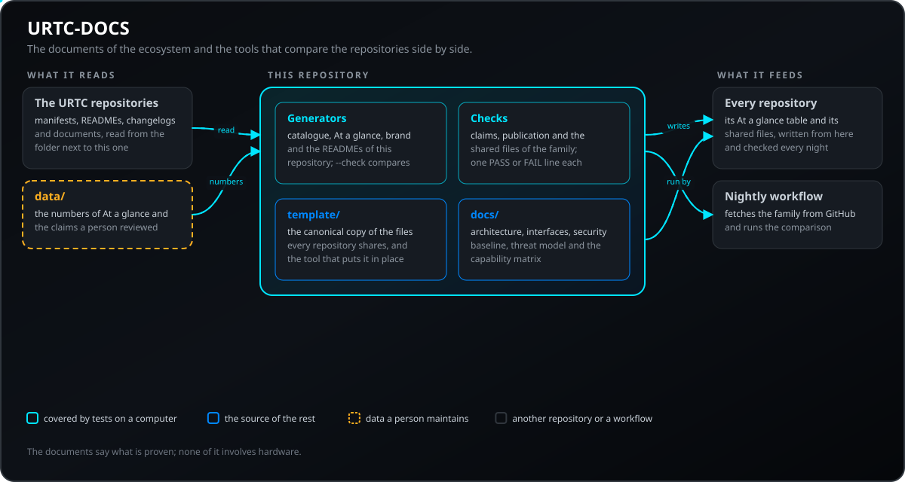
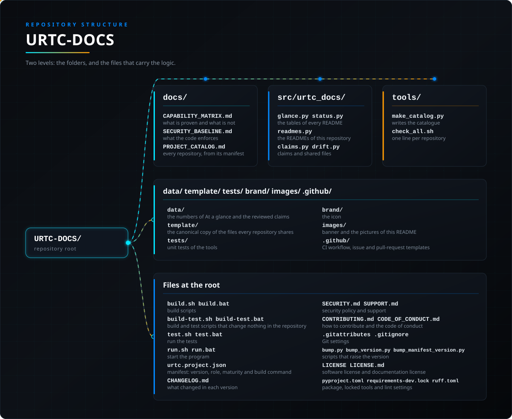

<p align="center">
  
</p>

# 📚 URTC-DOCS

<p align="center"><a href="README.md">🇺🇸 English</a> | <a href="README_spa.md">🇪🇸 Español</a> | <a href="README_fra.md">🇫🇷 Français</a> | <a href="README_ita.md">🇮🇹 Italiano</a> | <a href="README_deu.md">🇩🇪 Deutsch</a> | <a href="README_zho.md">🇨🇳 简体中文</a> | 🇯🇵 <b>日本語</b> | <a href="README_por.md">🇵🇹 Português</a></p>

### アーキテクチャ、インターフェース、セキュリティ基準、そして何が実証済みかという事実

<p align="center">
  
  
  
  
  
</p>

---

**正直さの確認 - 今日実際に動くもの：** このリポジトリにはドキュメントと小さなツールがあります。ツール（カタログ生成、ブランド素材生成、README 生成、公開前チェック、ファミリーチェック）は実在し、CI で実行される単体テストがあります。夜間ワークフローは、ファミリーの他のリポジトリに対してそれらを実行します。ドキュメントは、このバージョンのために読んだ時点の各リポジトリの README、マニフェスト、変更履歴、ドキュメントから書かれており、リポジトリまでたどれなかった記述はその旨を明記しています。ここにあるものはハードウェアテストではありません。能力マトリクスは各能力について、シミュレーションのみか、コンピュータ上でテスト済みか、実機で動作したかを示します。ファームウェアのリポジトリは、実装済みの基板がまだ存在しないと述べています。

---

> **安全性とセキュリティの現状:** このエコシステムは認証された安全システムではなく、実装済みの URTC 基板もまだ存在しません。ブートローダーはファームウェアイメージを CRC32 と共有鍵の HMAC-SHA256 で検査しており、非対称署名ではありません(予定)。公開されているアプリケーションイメージは公開の開発用鍵(`signing_key_kind: dev`)で署名されているため、誰でもブートローダーが受け入れるイメージを作れます。実際の基板には何も送信されていません。ここに書かれた内容を人の安全のために頼る前に、[セキュリティベースライン](docs/SECURITY_BASELINE.md)と[脅威モデル](docs/THREAT_MODEL.md)をお読みください。

## 📋 ひと目で

| | |
|---|---|
| バージョン | `0.1.2` |
| 成熟度 | 足場段階 |
| テスト | 178 |
| 技術 | Markdown / Mermaid / Python / SVG |
| 対象 | 利用者の PC |
| 実機での確認 | 対象外：ここにあるものはハードウェア上では動きません |

**移動先：** [概要](#-概要) · [アーキテクチャ](#-アーキテクチャ) · [クイックスタート](#-クイックスタート) · [テスト](#-テスト) · [構成](#-リポジトリの構成) · [関連](#-関連プロジェクト)

## 🚦 プロジェクトの状況

🟢 完了・検証済み · 🟡 動作するが既知の制限あり · 🟠 途中、または未検証 · 🔴 未実施または動作しない。実機で一度も動いていないものは緑になりません。

| 項目 | 状態 | リポジトリが示せること |
| --- | :---: | --- |
| ソフトウェア | 🟡 | カタログ、ブランド、README のジェネレーターと、公開前・主張・ファミリー全体の検査はコンピューター上で動作します。ハードウェアは関与しません。 |
| テスト | 🟡 | テストスイートはプッシュごとに CI で、Linux と Windows の両方で通ります。 |
| ファミリー全体の検査 | 🟡 | 夜間の実行でファミリーのすべてのリポジトリを取得し、概要表、主張、カタログの構造を比較します。カタログのバージョンが古い場合は報告されますが、夜間の実行は失敗扱いになりません。 |
| セキュリティ文書 | 🟡 | セキュリティの基準と脅威モデルは、読み取った時点の他のリポジトリをもとに書かれています。プロジェクト外の人によるレビューは受けていません。 |
| ドキュメント | 🟡 | 8 言語の README と参照ドキュメントがあります。翻訳はネイティブによるレビューを受けていません。 |

## 🎯 概要

<p align="center">
  
</p>

下の図は、URTC のリポジトリ、基板とパソコン側ツールをつなぐ CAN バス、そして各ドキュメントが述べる関係を示します。

* [アーキテクチャ](docs/ARCHITECTURE.md): レイヤー、データの流れ、ポート、信頼境界。
* [インターフェース](docs/INTERFACES.md): 各契約の所有者と、その文書の場所。
* [能力マトリクス](docs/CAPABILITY_MATRIX.md): ソフトウェアで実証済みのものとハードウェアが必要なものを、プロジェクトごとに。
* [セキュリティ基準](docs/SECURITY_BASELINE.md): コードが強制していることとまだ足りないこと。および[脅威モデル](docs/THREAT_MODEL.md)。
* [最初の垂直スライス](docs/FIRST_VERTICAL_SLICE.md): 今日存在する最小のエンドツーエンド経路。
* [CAN プロトコルの重複実装](docs/CAN_PROTOCOL_DUPLICATION.md): プロトコルは文章の説明から三回実装されています。共有仕様に含まれるはずの内容。
* [プロジェクトカタログ](docs/PROJECT_CATALOG.md): エコシステムの全リポジトリを、それぞれのマニフェストから生成。
* **ツール：** `make_catalog.py` はカタログを、`make_brand.py` はバナー・アイコン・ファミリーマップを、`make_readmes.py` はこのリポジトリの 8 つの README を書きます。`publication_check.py` は公開前に非公開のものを探し、`check_all.sh` はファミリーの各リポジトリ自身のチェックを実行して、1 件ごとに PASS、FAIL、SKIP の 1 行を出力します。 `make_glance.py` は各リポジトリのマニフェストと `data/glance.json` から「ひと目で」の表を書きます（`--check` は比較、`--apply` は書き込み）。バージョンを上げた後は `python tools/make_glance.py --apply --repo NAME` でそのリポジトリの表を更新します。`check_claims.py` は、ファミリーの各リポジトリの英語 README を読み、リスクのある語(E-STOP、インターロック、リアルタイム、署名済み、mTLS、FDCAN、YOLO、AI 駆動、自律、認証済みなど)を含む文の隣に状態の印(計画中、未実装、任意、既定で無効、シミュレーション、テスト済みなど)がなく、かつ担当者がコードと突き合わせて読み `data/claims_reviewed.json` に登録した行でもない場合に失敗します。 `check_repo_tools.py` は、各リポジトリが同一のコピーとして持つファイル(ドキュメント方針と README 同等性の検査、マニフェストのバージョン更新ツール、ダッシュボードへ通知するワークフロー)を比較し、どれかが異なると失敗します。 `sync_repo_tools.py` は、それらのファイルの正規コピー(`template/eh3d-repo-template`)を各ファイルの改行コードを保ったまま全リポジトリへ書き込みます。`--apply` を付けない場合は、変更される内容を一覧表示するだけです。 同じツールが、各リポジトリに `tools/devtools.lock.json` というロックファイル(URTC-DEVTOOLS の共有セットのバージョンと、共有ファイルごとの SHA-256)を書き込んで検査し、編集されたコピー、欠けているファイル、ロックに載っていないファイル、セットより古いままのコピーを報告します。`status_lights.py` も共有ファイルの一つで、各リポジトリのバリデーターは、Project status 表のランプがマニフェスト(`maturity`、`evidence`)の許す範囲を超えていると失敗します。 `urtc_doctor.py` は唯一の入口です。マシンのツール（Python、git、Node、ARM コンパイラー、PySide6、シリアルポート）、各リポジトリのバージョン（マニフェスト、ソースファイル、changelog の最新エントリ）、URTC-COMMON のコピー、フラッシャーと Web スタジオに同梱されたファームウェア、各リポジトリの検証、そしてこのリポジトリのチェックを 1 つのレポートにまとめます。`--fast` は検証を省略し、`--online` は同梱ファームウェアを最新リリースと比較します。

## 🧩 URTC での役割

URTC-DOCS はエコシステムの記憶です。アーキテクチャ、インターフェース、セキュリティ基準、能力マトリクスがここにあり、すべてのリポジトリを並べて比較するツールもここに置かれています。各リポジトリは自分の README、テスト、契約を持ち続けます。このリポジトリは、それらがどう組み合わさるか、そして実際に何が実証されたかを述べます。

## 🏛️ アーキテクチャ

<p align="center">
  
</p>

このリポジトリの各部分の関係。図は `docs/architecture.json` から描かれ、コードと照合されます。

## 🚀 クイックスタート

**必要なもの：** Python 3.10 以降、テスト用に pytest

```bash
python tools/make_catalog.py --check                 # カタログが最新（このリポジトリの隣に他のリポジトリが必要）
python tools/make_brand.py --check                   # バナー、アイコン、マップが最新
python tools/make_readmes.py --check                 # 8 つの README が最新
python tools/make_glance.py --check                  # ファミリー全体の「ひと目で」の表が最新（このリポジトリの隣に他のリポジトリが必要）
python tools/publication_check.py                    # 公開で非公開のものが外に出ない
python tools/check_claims.py --require-siblings      # どの README も、状態を示さずにリスクのある機能を主張していない(このリポジトリの隣に他のリポジトリが必要)
python tools/check_repo_tools.py --require-siblings  # 各リポジトリが同一コピーとして持つファイルは同じ内容(このリポジトリの隣に他のリポジトリが必要)
bash tools/check_all.sh                              # 各リポジトリのチェックを 1 行ずつ
python tools/urtc_doctor.py                          # ドクター：このマシンと各リポジトリについての 1 つのレポート
python -m pytest tests -q                            # ツールの単体テスト
```

## 🧪 テスト

テストスイートは 178 件です（`python -m pytest tests -q`）。カタログ、ブランド、「ひと目で」の表、状況の表、README のジェネレーターをテストデータで実行し、主張・共有ファイル・公開・doctor の検査、CAN の説明の適合ベクトルを確かめ、このリポジトリの README がジェネレーターの出力とまったく同じであることを検査します。

## 🏗️ ビルドとリリース

`build.sh` / `build.bat` はパッケージをインストールしてテストを実行し、`build-test.sh` / `build-test.bat` はインストールせずに確認します。どちらもバージョンは変えません。

## 📂 リポジトリの構成

<p align="center">
  
</p>

<details>
<summary>ツリーのテキスト版</summary>

```text
URTC-DOCS/
├── docs/                                              アーキテクチャ、インターフェース、機能マトリクス、セキュリティ基準、脅威モデル、生成されたカタログ
├── src/urtc_docs/                                     パッケージとしてのツール：カタログ、ブランド、README、ひと目で、状況、検査
├── tools/                                             パッケージの上の薄いスクリプト、check_all.sh、共有 CI チェック
├── data/                                              ひと目での数値と確認済みの主張
├── template/                                          全リポジトリが共有するファイルの正本
├── tests/                                             ツールのユニットテスト
├── brand/                                             アイコン
├── images/                                            バナーとこの README の画像
├── .github/                                           CI ワークフローと Issue・プルリクエストのテンプレート
├── build.sh build.bat                                 ビルドスクリプト
├── build-test.sh build-test.bat                       リポジトリを変更しないビルド・テストのスクリプト
├── test.sh test.bat                                   テストを実行
├── run.sh run.bat                                     プログラムを起動
├── urtc.project.json                                  マニフェスト：バージョン、役割、成熟度、ビルドコマンド
├── CHANGELOG.md                                       各バージョンの変更内容
├── SECURITY.md SUPPORT.md                             セキュリティポリシーとサポート
├── CONTRIBUTING.md CODE_OF_CONDUCT.md                 貢献方法と行動規範
├── .gitattributes .gitignore                          Git の設定
├── bump.py bump_version.py bump_manifest_version.py   バージョンを上げるスクリプト
├── LICENSE LICENSE.md                                 ソフトウェアとドキュメントのライセンス
└── pyproject.toml requirements-dev.lock ruff.toml     パッケージ、固定されたツール、lint 設定
```

</details>

## 🗺️ ロードマップと既知の制限

**現時点で分かっている制限**

* セキュリティ基準と脅威モデルは、読み取った時点の他のリポジトリから書かれており、プロジェクト外の人によるレビューは受けていません。
* 夜間の実行は、ファミリーのすべてのリポジトリを取得して、概要表・主張・カタログの構造を比較します。カタログ内の古いバージョンは報告されますが、その夜の実行は失敗になりません。
* これらの文書はソフトウェアを説明するもので、ハードウェアは関与せず、ボードに関する主張を実機で確認したものはありません。

**次のステップ**

* リポジトリの変化に合わせて、カタログ、「ひと目で」の表、機能マトリクスを最新に保ちます。

## 🌍 言語

README とテキストは、英語、スペイン語、フランス語、イタリア語、ドイツ語、中国語、日本語、ヨーロッパポルトガル語で提供されています。

## 🔗 関連プロジェクト

URTC は独立したリポジトリで構成され、それぞれに固有のバージョン、テスト、README があります。グループ別のファミリーは次のとおりです：

* **URTC Tool Platform:**
  * [URTC](https://github.com/JuanenRac/URTC) - ツールヘッド基板のファームウェア(25 のツールプロファイル、CAN ブートローダー)と CAN プロトコルのリファレンス。
  * [URTC-COMMON](https://github.com/JuanenRac/URTC-COMMON) - 一度だけデータとして書かれた CAN プロトコル(仕様、生成された表、適合ベクトル)と、各プログラムが共有するコード。
  * [URTC-FLASHER](https://github.com/JuanenRac/URTC-FLASHER) - CAN または SWD/JTAG で基板のファームウェアを更新するデスクトップツール。
  * [URTC-GATEWAY](https://github.com/JuanenRac/URTC-GATEWAY) - CAN バスの手前に置くゲートウェイ。一覧にある識別子だけを通し、レートを制限し、セッション鍵を求めます。
  * [URTC-SMART-RACK](https://github.com/JuanenRac/URTC-SMART-RACK) - 予熱とライフサイクル追跡を備えたツールラック向けの、ハードウェア非依存の C ロジックとコマンドプロトコル。
  * [URTC-TESTER](https://github.com/JuanenRac/URTC-TESTER) - 基板が報告するツールプロファイルの操作部とテレメトリを表示する、デスクトップ用のライブ CAN バステスター。
  * [URTC-VISION-TOOL](https://github.com/JuanenRac/URTC-VISION-TOOL) - C のセンサーフレームプロトコルと、検査用ツールヘッド向けの Python サーマル/RGB コンパニオン。
  * [URTC-WEB-STUDIO](https://github.com/JuanenRac/URTC-WEB-STUDIO) - Web Serial と SLCAN で基板の書き込みとテストを行うブラウザアプリ。インストール不要。
* **Ecosystem Operations:**
  * [URTC-DEVTOOLS](https://github.com/JuanenRac/URTC-DEVTOOLS) - ファミリー共通のリポジトリツールを、版数付きの一つのセットとして提供します。ロックファイルで、編集されたコピーと古いままのコピーを見分けられます。
  * **URTC-DOCS** (このリポジトリ) - エコシステムのアーキテクチャ、インターフェース、セキュリティベースライン、生成されたカタログと、全リポジトリを比較するツール。
  * [URTC-UPDATER](https://github.com/JuanenRac/URTC-UPDATER) - URTC ファミリーのリポジトリを検出・インストール・更新するデスクトップツール。操作は一つずつ明示的に行います。

**姉妹プロジェクト（独立しており、基盤とツールを共有）：**

* **[HYDRA-UMC-DOCS](https://github.com/JuanenRac/HYDRA-UMC-DOCS)** - 姉妹プロジェクト：HYDRA-UMC のドキュメントハブ。基盤とツールを共有する独立したエコシステム
* **[ARMOR-DOCS](https://github.com/JuanenRac/ARMOR-DOCS)** - 姉妹プロジェクト：A.R.M.O.R. セキュリティエコシステムのドキュメントハブ。こちらも独立し、同じ基盤の上にある
* **[JuanenRac](https://github.com/JuanenRac/JuanenRac)** - すべてのエコシステムのプロフィールとステータスダッシュボード

## 📚 ドキュメント

さらに読むには：

* [能力マトリクス：実証済みのものとそうでないもの](docs/CAPABILITY_MATRIX.md)
* [プロジェクトカタログ：各リポジトリのバージョンと種類](docs/PROJECT_CATALOG.md)
* [CAN プロトコル：文章による一つの仕様の三つの実装](docs/CAN_PROTOCOL_DUPLICATION.md)
* [このリポジトリの変更履歴](CHANGELOG.md)
* [ライセンス (GPL-3.0-or-later)](LICENSE)

## 🤝 コントリビュートとコミュニティ

* プルリクエストの前に `URTC_CI=1 python tools/ci_validate.py` を実行してください。通過する必要があります。[CONTRIBUTING.md](CONTRIBUTING.md) と[行動規範](CODE_OF_CONDUCT.md)を参照してください。
* README は 8 言語で提供されています。文章の変更は 8 つのファイルすべてで行い、他のリポジトリと共有するセクションは URTC-COMMON の `tools/readme_sections.py` が書き込みます。
* ビルドしただけのものを、ボード上で動いているかのように書かないでください。
* 脆弱性は非公開で報告してください：[SECURITY.md](SECURITY.md)。質問、アイデア、報告：electrohobby3d@gmail.com（[SUPPORT.md](SUPPORT.md)）。
* 質問、アイデア、報告：electrohobby3d@gmail.com

## 👤 作者

**JuanenRac (Electro Hobby 3D)** · electrohobby3d@gmail.com

## 📜 ライセンス

ソフトウェア：GPL-3.0-or-later - [LICENSE](LICENSE) を参照。ドキュメント：CC BY-SA 4.0 - [LICENSE.md](LICENSE.md) を参照。
