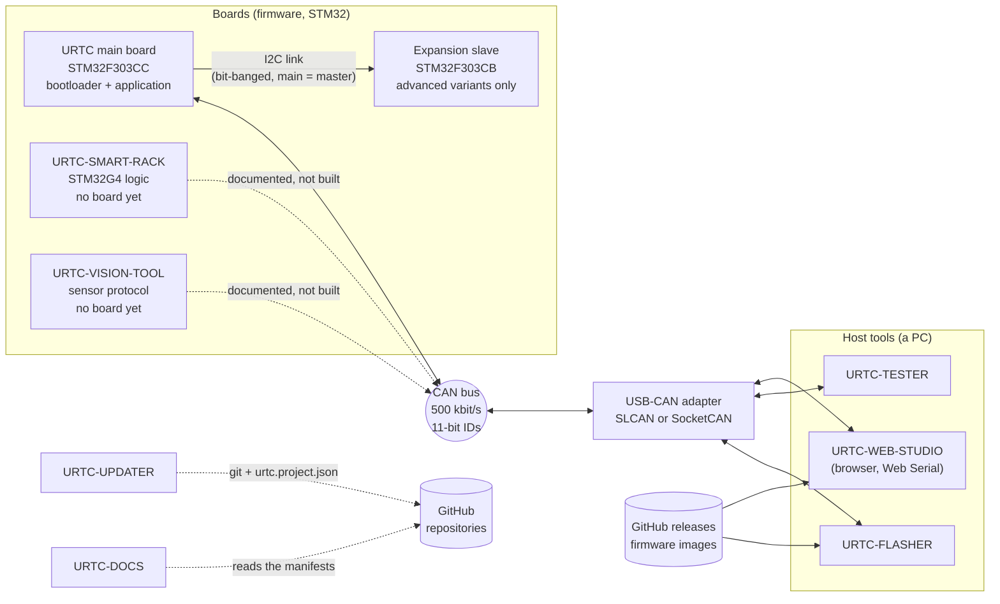

<!--
=============================================================================
URTC-DOCS - Architecture of the URTC ecosystem
Copyright (C) 2026 JuanenRac (Electro Hobby 3D) <electrohobby3d@gmail.com>
CC BY-SA 4.0 - see LICENSE.md
=============================================================================
-->

# Architecture

How the URTC repositories fit together: the boards, the CAN bus, the host tools, what travels between them and where one part has to trust another. It is written from the READMEs, manifests, changelogs and `docs/` of the repositories as they were read for this version of URTC-DOCS. A sentence that no repository states is marked **(not traced)**, and everything about real hardware is bounded by the one fact that colours every page of this repository:

> **No populated URTC board exists yet.** The firmware repository says so in its status section ("schematic and BOM are still being finalized; no populated board exists yet to validate any of the above against real silicon"), and the three PC tools say that none of them has been run against a real board. Everything below describes software that compiles, that has host tests, or that has been exercised against a simulator.

## The ecosystem in one picture

## Layers

| Layer | What lives there | Repositories |
|---|---|---|
| Tool head | One board per tool head. The firmware reads a 5-bit solder-jumper ID, resolves it to one of 25 tool profiles, drives that tool's power stage and sensors, shows live state on an OLED and two RGB LED outputs, and keeps the active setpoints in an I2C F-RAM. | `URTC` (`src/F303-master`) |
| Expansion | A 20-pin expansion connector takes one of six add-on board variants. The two *advanced* variants carry a second microcontroller (STM32F303CBT6) with its own bootloader and application; it has no CAN peripheral and is reached only through the main board over a bit-banged I2C link. | `URTC` (`src/F303-slave`, `docs/EXPANSION.TXT`) |
| Bus | Classic CAN at 500 kbit/s, standard 11-bit identifiers, at most 8 data bytes, multi-byte fields big-endian. One prose reference defines every identifier and payload. | `URTC` (`docs/CANBUS.TXT`) |
| Adapter | A USB-CAN adapter. The tools reach it through SLCAN (an ASCII protocol over a virtual serial port), through Linux SocketCAN, or (FLASHER only) through `python-can`. | adapter hardware, not in any repository |
| Gateway | An optional program in front of the bus: only the listed identifiers cross, payloads are checked against the specification, the rate is limited and a peer proves it holds a key. Software only, for an installation that cannot keep the bus closed. | `URTC-GATEWAY` |
| Shared code | The protocol as data (specification, generated tables, conformance vectors), the transports, the virtual board, the models of the rack and of several heads, the windows and the texts the tools share. It is copied into each tool with a lock file. | `URTC-COMMON` |
| Host tools | Flash the firmware, exercise a running tool head, or do both in a browser. | `URTC-FLASHER`, `URTC-TESTER`, `URTC-WEB-STUDIO` |
| Neighbouring boards | A tool rack with Smart Idle pre-heating and an inspection head with a thermal and an RGB camera. Both are, so far, hardware-independent C logic with host tests plus a cross-compile; neither has a board. | `URTC-SMART-RACK`, `URTC-VISION-TOOL` |
| Operations | Find, install and update the repositories on a machine; keep the cross-repository documents. | `URTC-UPDATER`, `URTC-DOCS` |
| Above the ecosystem | The profile repository builds the status dashboard from every manifest; `ELECTRO-HOBBY-3D-UPDATER` dispatches to the updaters of the three ecosystems. | `JuanenRac`, `ELECTRO-HOBBY-3D-UPDATER` |

## The board

* **Microcontroller:** STM32F303CCT6 (LQFP48, 256 KB flash). The firmware repository reports the main application, the main bootloader, the slave application and the slave bootloader as four independently versioned components.
* **Flash layout of the main board** (from the firmware README): a 30 KB bootloader, a 2 KB metadata page, a 112 KB main slot and a 112 KB backup/staging slot. An update is always written to the backup slot first and copied into the main slot only after its size, CRC32 and HMAC-SHA256 signature have been verified. The metadata page records HardwareID, version, size, CRC32 and the signature.
* **Tool selection:** five jumper inputs (ID0-ID4) give 32 readings. Thirty-one map to a profile; the reading `11111` means "free configuration": the tool is looked up in the F-RAM, where it was written over CAN beforehand. Twenty-five profiles are defined (soldering station, dispensers, screwdriver, vacuum gripper, drill, gimbal and NEMA grippers, AOI head, laser, 3D-printer hotend, scan probe, pick-and-place head, electromagnet, spot welder, conformal coating, flying probe, UV curing, hot-air rework, press-fit inserter, crimping actuator, thermal inspection, paste jetting, ultrasonic welder and the others of `docs/TOOLS.TXT`).
* **Persistence:** an FM24CL64B F-RAM keeps a periodic snapshot of the active tool's setpoints and the LED/OLED settings. After a reset the snapshot is *readable* over CAN (`0x190`/`0x191`) but is never re-applied to a heater, laser or motor on its own; only passive settings (LED colours, OLED mode) are restored.
* **Local safety behaviour that the firmware documents:** a communication watchdog on every actuator (250 ms for the laser, drill, heaters, fans, UV), a thermal-runaway guard that cuts a heater and latches the board error (`thermal_guard.c`), range checks on what the board measures, a declared critical error that blocks every command except lighting until reset, and a 4-byte magic payload on destructive one-shot commands.
* **Diagnostics over CAN:** active tool and quick state (`0x110`/`0x111`, including the thermal fault code and the last reset cause), CAN error counters (`0x7FB`/`0x7FC`), lifetime thermal counters (`0x1AA`/`0x1AB`), peripheral type and serial number (`0x1A4`/`0x1A5`).

## The host tools

| Tool | Stack | What it does | Transports it carries |
|---|---|---|---|
| URTC-FLASHER | Python; Qt Quick deck (the only window); headless `--cli` | Updates the main board or the expansion slave over CAN with the bootloader protocol (HardwareID check, HMAC-SHA256 chunks sent from a published signature, page acknowledgements, verify); reads back the installed firmware over CAN; queries versions including the patch number; full-chip SWD/JTAG programming through pyOCD or STM32CubeProgrammer (in the window, not in the headless `--cli`); downloads images from the assets of a GitHub release. | SLCAN, SocketCAN, python-can, and an in-memory simulated bootloader (`MockCAN`) |
| URTC-TESTER | Python; Qt Quick deck (the only window) | Asks the board which tool profile it is jumpered for and shows only that tool's controls and telemetry; never touches flash, in its README's words. Every output goes through the encoders of `advanced_protocol.py`, which reject out-of-range values instead of clamping them. | SLCAN, SocketCAN |
| URTC-WEB-STUDIO | TypeScript, React, Vite; Web Serial | The main workflows of the two desktop tools in a browser tab (Flasher Studio, Tester Studio, a bus analyser) plus clearly labelled offline sandbox tabs that send nothing. | SLCAN over Web Serial |

All three speak the same wire protocol. URTC-COMMON holds a machine-readable specification of it, the shared vectors, the transports and the shared windows; each tool carries a copy of that shared code (`urtc_can/` in the two desktop tools, `src/lib/generated/` and `src/lib/*.ts` in the web studio) with a lock file, and its CI fails when a copy was edited or fell behind. URTC-GATEWAY and URTC-UPDATER carry copies of the parts they need too (see `CAN_PROTOCOL_DUPLICATION.md`).

## Data flows

1. **Runtime control and telemetry.** A host sends a command frame (for example `0x130` to set a soldering-iron temperature); the board answers with automatic telemetry about every 150 ms (`0x135`, `0x147`, ...) or with a response to a query. Which tool's frames are accepted depends on the active tool. A host learns the active tool with `0x110`.
2. **Firmware update over CAN.** The application is told to enter the bootloader (`0x7F0` with a magic payload); the host sends the size and HardwareID (`0x7F1`), the four 8-byte HMAC chunks (`0x7F7`), the data frames (`0x7F2`) with a page acknowledgement per 2 KB page (`0x7F3`), and the end frame with the CRC32 and version (`0x7F4`). The bootloader verifies the backup slot and copies it to the main slot, or reports why not (`0x7F5`, reasons 1-5). A downgrade needs a one-shot authorisation (`0x7FD`). The installed image can be read back (`0x7FE`/`0x7FF`). The expansion slave is updated the same way through the relay IDs `0x210`-`0x219`.
3. **Version query.** `0x7F8` is answered by whichever side is running (`0x7F9`, and `0x7FA` from the bootloader); `0x7E9` adds the patch number and a capability flag. A host that sees no `0x7E9` within a short grace window treats the patch as unknown and keeps the legacy two-component payload.
4. **Firmware distribution.** Binaries are not in git. `URTC`, `URTC-SMART-RACK` and `URTC-VISION-TOOL` publish them only as assets of the GitHub release of each version, next to `.sha256` sidecars and manifests that carry the signature the bootloader expects. FLASHER and WEB-STUDIO keep no image in git: they read the newest official release (or a chosen tag), compare each image with its published digest, check the detached Ed25519 release signature of every asset when it is there, and send the published signature to the board; neither ships a key (for an image with no published signature both ask for a key typed at run time).
5. **Several tool heads on one bus.** The multinode extension of the firmware (off by default; a bus with one head works as before) lets the host find the heads, select one and release it. The rules are written once in URTC-COMMON and carried by the flasher, the tester and the web studio, which refuse a single-head command until one head is selected and confirmed. Tried against a model of the bus only (`MULTINODE.md` in URTC-COMMON).
6. **Discovery of the repositories.** Every repository carries `urtc.project.json`. URTC-UPDATER reads those files (and the native version file) from local checkouts and from GitHub's raw-content host, compares versions, and after an explicit confirmation clones or pulls a repository into a staging directory, runs that repository's non-versioning `build-test` script and promotes it; it can also install FLASHER, TESTER and itself from the signed package of a release (`package list|check|install|rollback`). The profile repository's workflow does the same discovery to build the dashboard, and each repository's `dashboard-dispatch.yml` asks for a refresh once the CI of a push to `main` has finished green, when the optional secret is configured.

## Trust boundaries

| Boundary | What crosses it | What the other side relies on |
|---|---|---|
| Host to bus (through the adapter) | Any 11-bit frame with up to 8 bytes | Nothing. There is no sender authentication and no encryption on the bus; a node that can put a frame on the wires is obeyed as the master. The firmware protects against accidents, not against a hostile node. |
| Bus to bootloader | The update frames | A valid HMAC-SHA256 under the board's key, CRC32, matching HardwareID, and (unless authorised) a version not older than the installed one. This is the one place where a hostile node is stopped, as long as the key stays private. |
| Signing key to bootloader | The key compiled into the bootloader | A build without `URTC_SIGNING_KEY_FILE` uses the public development key, so anybody can sign for such a board. Release builds refuse that key. |
| GitHub release to FLASHER / WEB-STUDIO | Image, `.sha256`, manifest, detached `.sig` | The host refuses an image whose sha256 does not match its published digest and, when the Ed25519 release signature of an asset is there, one that does not verify against the pinned key of the releases (`URTC/docs/RELEASE_SIGNING.md`). The HMAC signature of the image itself is verified only by the bootloader. |
| GitHub to URTC-UPDATER | A clone of a repository and its build script | The updater runs that repository's own `build-test` script after cloning, before promotion. By default (`warn`) an unsigned commit is installed with a warning; `require` refuses an unsigned candidate before anything is read or built. |
| Browser to adapter (WEB-STUDIO) | Web Serial access | The user grants a serial port to the page. Sandbox tabs are kept apart from the real bus by code that is unit-tested; the transport itself is not. |
| Board to the machine it sits on | Heater, laser, motor, weld and UV outputs | The installation, not the firmware: the threat model requires a hardware interlock independent of the microcontroller for the laser and any head that can injure or start a fire, and an emergency stop that cuts power rather than sends a frame. |

## Where URTC meets the other ecosystems

* **HYDRA-UMC.** The URTC README states that the tool head sits on the FDCAN2 relay tunnel of the HYDRA-UMC motherboard, and the CAN reference is titled for "URTC/HYDRA-UMC". The relay itself belongs to the HYDRA-UMC firmware repository and was not read for this document **(not traced)**.
* **Profile and dashboard.** The `JuanenRac` repository discovers URTC repositories through URTC-UPDATER's client and a pinned revision of it.
* **ELECTRO-HOBBY-3D-UPDATER.** Its manifest has a different ecosystem identifier, so no updater discovers it by design; it forwards to the three updaters.

## What this document does not show

* Any measured timing, bus load, latency or real-board behaviour.
* The electrical design (schematic, BOM and layout are in the firmware repository's `PCB`, `BOM` and `docs/PINOUT*.TXT` and are still being finalised).
* The internals of URTC-SMART-RACK and URTC-VISION-TOOL beyond what their READMEs say; their own frame formats (versioned framing with a CRC8) are not the CAN reference of the tool head.
